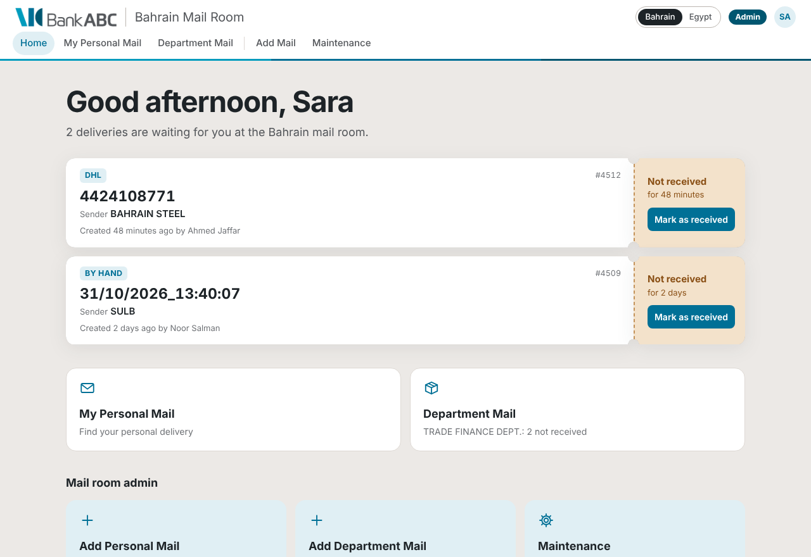
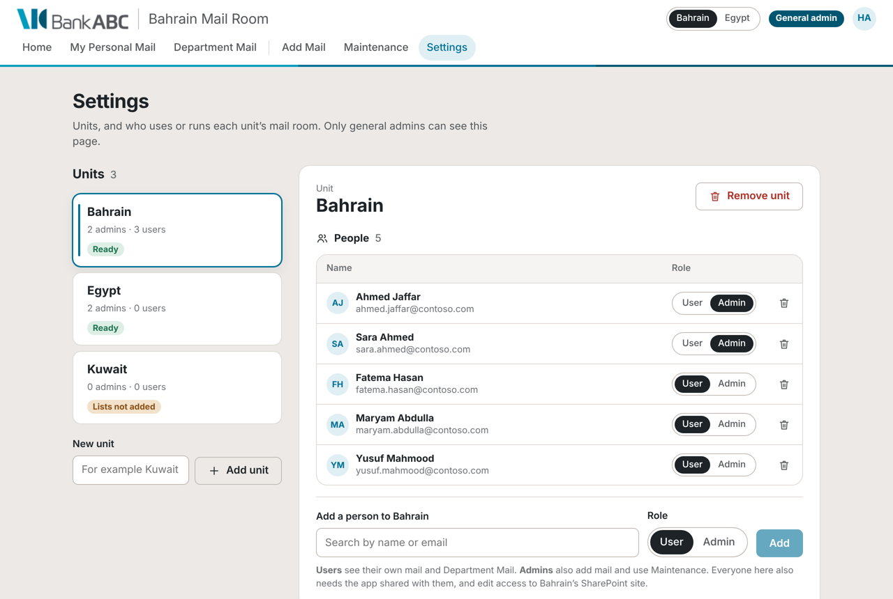
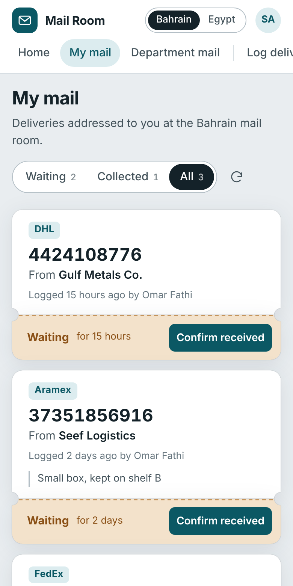

# Mail Room

A mail room app for Bank ABC, built as a [Power Apps code app](https://learn.microsoft.com/power-apps/developer/code-apps/) (React + TypeScript + Vite). It keeps the screens, fields and lists of the original **Bahrain Mail Room** SharePoint site, with a modern design and the Bank ABC brand.



## What it does

**Everyone in a unit**
- **Home** shows the personal mail waiting for you, with **Mark as received** on each delivery.
- **My Personal Mail** lets you find your personal delivery, not received or received.
- **Department Mail** lets you find delivery for a department, with the original filters: Courier Number, Department, Date, Courier Company, Sender Company and Received.

**Mail room admins only**
- **Add Personal Mail** has the fields Courier Number, Courier Company, Sender and Recipient.
- **Add Department Mail** has the fields Courier Number, Courier Company, Department and Sender Company.
- Both forms show the live time stamp, with Submit, Reset and Cancel. They work with barcode scanners, and **BY HAND** fills in a time-stamp reference.
- **Maintenance** shows the original list columns. Use it to edit a delivery, mark it received (on behalf of the recipient if someone else collects), or set it back to not received.

**General admins only**
- **Settings** is where you add and remove units, and add people to each unit as a **User** or an **Admin**.



## Units, people and admins

Everything is managed on the **Settings** page, which only general admins can see.

| Who | Sees |
| --- | --- |
| **User** of a unit | Home, My Personal Mail and Department Mail, for their unit only |
| **Admin** of a unit | The same, plus Add Mail and Maintenance for that unit |
| **General admin** | Every unit as an admin, plus Settings |
| Anyone else | A "no access" message |

- Someone can be in several units (for example a supervisor). They get a unit switcher.
- Pages someone can't use don't exist for them. There is no navigation, no tile, and a link to the page opens Home instead.
- **General admins** are listed in `GENERAL_ADMINS` in [`src/config.ts`](src/config.ts), not in Settings, so nobody can lock them out. Right now that's only `hawra.alhujairy@bank-abc.com`.

**Each unit's data is separate**, with two locks:
1. Every unit (Bahrain, Egypt, …) keeps its mail in its own two SharePoint lists, ideally on its own site, as with the original `/sites/MailRoom/Bahrain`. Only that unit's people get access to the site, so nobody else can open its records, in the app or in SharePoint.
2. The app only opens the units a person is a member of in Settings. Other units' lists are never queried, and their names never appear.

Keep in mind:
- The admin role is enforced by the app. Users still need Edit permission on their unit's lists so they can mark mail as received, which means they could edit list items directly in SharePoint. If that matters, the next step is a Power Automate flow that marks items received for them, so users only need Read access.
- The settings lists must be **read-only for everyone except the general admins**. Otherwise people could add themselves to a unit directly in SharePoint.

## Lists and fields

Each unit has two lists named after it, for example **BahrainPersonalMail** and **BahrainDepartmentMail**:

| Personal mail | Department mail | Notes |
| --- | --- | --- |
| ID | ID | Built in |
| Courier Number | Courier Number | The built-in Title column, renamed |
| Courier Company | Courier Company | |
| Sender | Sender Company | |
| Recipient | Department | |
| Recipient Email | | Used to find each person's mail |
| On Behalf | | Filled when someone collects for the recipient |
| Creation Time Stamp | Creation Time Stamp | The built-in Created column |
| Created By | Created By | The built-in Created By column |
| Received | Received | `Yes` or `No` |
| Received By | Received By | |
| Received By Email | Received By Email | |
| Received Time Stamp | Received Time Stamp | |

The two **settings lists** hold the units and their people:

| MailroomUnits | MailroomMembers |
| --- | --- |
| Unit (the built-in Title column, renamed) | Email (the built-in Title column, renamed) |
| | Name (`MemberName`) |
| | Unit |
| | Role: `Admin` or `User` |

Everything is stored in these SharePoint lists; the app has no demo data. Until the settings lists are added, general admins see a setup screen with these steps, and everyone else sees "not set up yet". The screenshots use placeholder names.

## Deploy

> **Step-by-step with copy-paste commands:** [SETUP-STEPS.txt](SETUP-STEPS.txt) (open the raw file and save it, or copy it into Notepad). Moving to a production environment: [MOVE-TO-PROD.txt](MOVE-TO-PROD.txt).

Use a **Command Prompt** terminal in VS Code. If you see a certificate error, run `set NODE_USE_SYSTEM_CA=1` first.

```
cd %USERPROFILE%\Documents
git clone https://github.com/Hujairy/MailRoom.git
cd MailRoom
npm install
pa app init --display-name "Mail Room" --environment-id <your-environment-id>
npm run build
pa app push
```

If you already cloned it, run `git pull` and `npm install` in the folder instead, then `npm run build` and `pa app push`.

**App icon:** `docs/app-icon.png` is the Bank ABC tile, 512 × 512. If Power Apps offers an icon setting for the app, upload it there.

## Set up the lists

Until this is done, the app opens on a setup screen with the same steps, where you can type your site addresses to fill in the commands.

### 1. Create the lists in SharePoint

Create each list from **+ New → List → Blank list**, with the name exactly as shown. For each column, choose **+ Add column → Single line of text** and type the name exactly as shown, **with no spaces** (you can rename it afterwards; the app uses the first name). Don't add any items.

**Settings lists**, on a site that everyone who uses the app can **read**, but only general admins can **edit**, for example a new *Mail Room Settings* site. Otherwise people could add themselves to a unit directly in SharePoint.

| List | Columns to add |
| --- | --- |
| `MailroomUnits` | None. The built-in Title column holds the unit name. |
| `MailroomMembers` | `MemberName`, `Unit`, `Role`. Title holds the person's email. |

**Each unit's lists**, ideally on the unit's own site, starting with Bahrain. Give only the unit's people (ideally one Entra ID group) **Edit** access to that site.

| List | Columns to add |
| --- | --- |
| `BahrainPersonalMail` | `CourierCompany`, `Sender`, `Recipient`, `RecipientEmail`, `OnBehalf`, `Received`, `ReceivedBy`, `ReceivedByEmail`, and `ReceivedTimeStamp` |
| `BahrainDepartmentMail` | `CourierCompany`, `Department`, `SenderCompany`, `Received`, `ReceivedBy`, `ReceivedByEmail`, and `ReceivedTimeStamp` |

- `ReceivedTimeStamp` is **Date and time**, with **Include time** turned on. Everything else is single line of text.
- `Received` holds the text `Yes` or `No`. Don't make it a Yes/No column.
- A unit with spaces in its name drops them: *Saudi Arabia* uses `SaudiArabiaPersonalMail`.
- Once a list has a few thousand items, index `Received` on both mail lists and `RecipientEmail` on the personal list (**List settings → Indexed columns**).

<details>
<summary>Creating the lists with PowerShell instead</summary>

If you can run PowerShell 7.4+ with [PnP.PowerShell](https://pnp.github.io/powershell/) (it needs an Entra ID app registration from IT):

```powershell
./scripts/Create-MailroomSettingsLists.ps1 -SiteUrl https://<tenant>.sharepoint.com/sites/<settings-site> -ClientId <entra-app-client-id>
./scripts/Create-MailroomLists.ps1 -Unit Bahrain -SiteUrl https://<tenant>.sharepoint.com/sites/<bahrain-site> -ClientId <entra-app-client-id>
```
</details>

### 2. Add the lists to the app and publish

In VS Code's Command Prompt, in the MailRoom folder. `pa connection list` shows your SharePoint connection's id; if there isn't one, create it at make.powerapps.com under **Connections**.

```
pa connection list
pa app add data-source --connector "shared_sharepointonline" --connection-id "<id>" --dataset "https://<tenant>.sharepoint.com/sites/<settings-site>" --table "MailroomUnits"
pa app add data-source --connector "shared_sharepointonline" --connection-id "<id>" --dataset "https://<tenant>.sharepoint.com/sites/<settings-site>" --table "MailroomMembers"
pa app add data-source --connector "shared_sharepointonline" --connection-id "<id>" --dataset "https://<tenant>.sharepoint.com/sites/<bahrain-site>" --table "BahrainPersonalMail"
pa app add data-source --connector "shared_sharepointonline" --connection-id "<id>" --dataset "https://<tenant>.sharepoint.com/sites/<bahrain-site>" --table "BahrainDepartmentMail"
pa app add data-source --connector "shared_office365users" --connection-id "<office365users-id>"
npm run build
pa app push
git add -A
git commit -m "Connect the SharePoint lists"
git push
```

The Office 365 Users line is optional but recommended. Admins can then find people by name, Department Mail opens on each person's department, and people whose sign-in name differs from their email address are still recognised.

### 3. Add units and people, and give them access

Open the app and go to **Settings**. Add each unit with the same name you used for its lists, then add its people as Users or Admins. People and roles take effect straight away; nothing needs rebuilding.

Everyone you add also needs:
- **The app shared with them** in Power Apps (make.powerapps.com → **Apps** → Mail Room → **Share**), and a Power Apps Premium license.
- **Read** access to the settings site, and **Edit** access to their unit's site.

**Adding another unit later:** add it in Settings. It shows **Lists not added**, with the list names and the commands to run. Create its two lists, add them to the app, and publish. **Remove unit** takes a unit and its people out of the app; its SharePoint lists and deliveries are kept.

## Notifications

The original forms "notify individuals" and "notify department". Add a Power Automate flow on each unit's lists:

- **Personal mail**: trigger **When an item is created**, then **Send an email (V2)** to `RecipientEmail`. For example: *"A delivery from {Sender} ({Courier Company} {Courier Number}) is waiting for you at the mail room."*
- **Department mail**: the same trigger, then a **Switch** on `Department` that emails each department's mailbox.

To link straight to a page, add `page=mine` or `page=department` to the app's link (`&page=…` if the link already contains `?`).

## Configure

Units and people are managed in **Settings**. For everything else, edit [`src/config.ts`](src/config.ts), then rebuild and push:

| Setting | What it changes |
| --- | --- |
| `GENERAL_ADMINS` | People with full access, including Settings |
| `COURIERS`, `BY_HAND` | Courier Company buttons |
| `DEPARTMENTS` | Extra department suggestions |
| `DATE_LOCALE` | Date format (default `en-GB`: 1 Nov 2026) |
| `PERSONAL_MAIL_LIST`, `DEPARTMENT_MAIL_LIST` | Column internal names, the same for every unit |
| `SETTINGS_LISTS` | Column internal names of the settings lists |

Brand colours are at the top of [`src/styles.css`](src/styles.css): cyan `#009CBD`, blue `#007096`, deep blue `#005670`, grey `#53565A`.

## Troubleshooting

- **The setup screen still shows**: MailroomUnits and MailroomMembers aren't added to the app yet. Add them (step 2), then build and push.
- **Someone can't open the app at all**: share the app with them in Power Apps, and check their license.
- **"You don't have access to Mail Room yet"**: the person can't read the settings lists. Give them Read access to the settings site.
- **"You don't have access to a mail room yet"**: the person isn't in any unit, or their address doesn't match. Add them in Settings with the address they sign in with, or add Office 365 Users (step 2) so either their sign-in name or their email works. Case doesn't matter.
- **"You can't open the … mail room yet"**: they're in the unit, but can't open its lists. Check the unit site's permissions.
- **A unit shows "Lists not added"**: its two lists aren't in the app, or their names don't match the unit's name. The unit's card shows the names it expects.
- **Settings doesn't appear**: only the emails in `GENERAL_ADMINS` see it.
- **"Column 'X' does not exist"**: a column's internal name differs. Check `src/generated/models/` and update the `columns` in `src/config.ts`.
- **A list's columns changed**: run `pa app refresh data-source --name <data-source-name>`.


